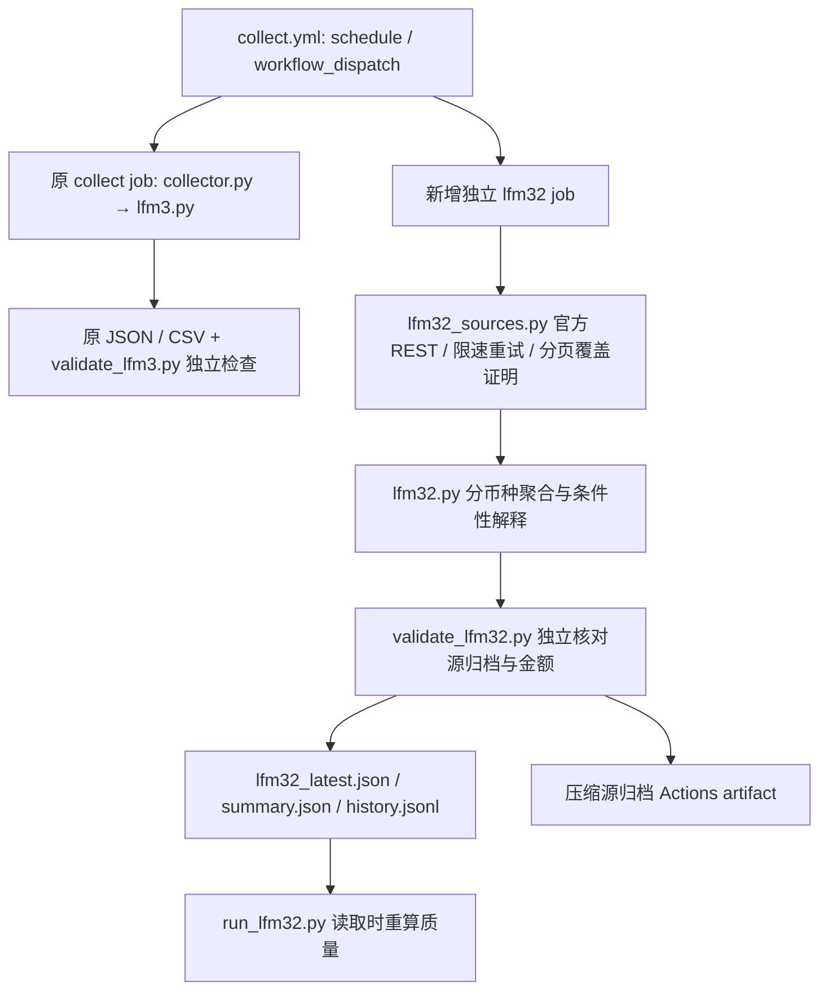

# LFM3.2 第一期开通说明

首次验收后的新增行为以 [修复说明](LFM32_FIXES.md) 为准：OKX独立合约背景、逐所现货评分、记录/撮合口径和真实调度审计。

本次在原仓库增量升级，不替换 LFM2 / LFM3.1 的公式、历史文件或质量门槛。第一期是每五分钟**尝试**运行的、有范围证明的 REST 轮询，不是完整实时逐笔监控。静态 JSON 必须在读取时重算新鲜度。

## 架构与模块



- `lfm32_sources.py`：独立的每源预算、有限重试、HTTP 状态及限速头审计。403/418/451 不绕过、不反复重试；429 遵守 Retry-After，超预算终止。
- `lfm32.py`：5/15/60 分钟真实主动买卖、大单分档及动态分位阈值、连续大单事件、窗口大单 CVD 序列、方向一致性、条件性杠杆解释与证据评分。每个交易所独立失败；全局两所现货资格失败时禁止跨所结论。
- `lfm32_config.json`：四个分档下限、分位数、最小样本数、分页和时间预算、连续事件门槛、买卖墙门槛、初始评分权重。
- `lfm32_orderbook.py`：第二期 Binance 快照+增量序列检查基础组件，测试了缓冲重放、重复、跨序列及失效后重新快照。**第一期没有连接 WebSocket，也不调用此组件来伪装连续订单簿。**
- `validate_lfm32.py`：检查归档 SHA256，从源记录独立复算金额、方向、ID连续性、大单 CVD、OI 变化、已结算费率、合约资金流及快照深度。
- `run_lfm32.py`：固定提交读取最新 JSON；`--refresh` 用已有 gh 授权触发手动采集，核对 request_id/run_id/生成时间，单独检查 lfm32 job，原工作流失败仍在报告中保留。
- `work_collect.py`：只修复此前运行标题已改为 `BTC collection <id>`、而原执行器仍寻找旧标题导致无法关联手动请求的问题；同时兼容旧标题。

## 官方数据源及语义

| 数据 | 官方接口 / 文档 | 使用与限制 |
|---|---|---|
| Binance 现货 | [aggTrades](https://developers.binance.com/docs/binance-spot-api-docs/rest-api/market-data-endpoints#compressedaggregate-trades-list)，`data-api.binance.vision/api/v3/aggTrades` | BTCUSDT、USDT。`m=true` 表示买方为 maker，故主动卖出；false 主动买入。每页至多1000条，时间起点种子后用 fromId 正向分页。|
| Coinbase 现货 | [BTC-USD trades](https://docs.cdp.coinbase.com/exchange/reference/exchangerestapi_getproducttrades)，`api.exchange.coinbase.com/products/BTC-USD/trades` | USD。REST `side` 是 maker，sell→主动买、buy→主动卖；cb-after 向过去分页，最多1000条/页。|
| 现货深度 | [Binance depth / 本地订单簿](https://developers.binance.com/docs/binance-spot-api-docs/web-socket-streams#how-to-manage-a-local-order-book-correctly)；[Coinbase book](https://docs.cdp.coinbase.com/exchange/reference/exchangerestapi_getproductbook) | 各所前10档、BTC 数量不平衡 `(bidBTC-askBTC)/(bidBTC+askBTC)`、本币报价墙。只有快照，无事件时间的响应仅记录 observed_utc。|
| OI | [Open Interest Statistics](https://developers.binance.com/docs/derivatives/usds-margined-futures/market-data/rest-api/Open-Interest-Statistics)，`fapi.binance.com/futures/data/openInterestHist` | BTCUSDT 永续5m历史，OI单位BTC、名义价值USDT；按官方 timestamp 对齐端点，5/15/60分钟端点不存在→null，不用轮询时间代替。官方历史有保留范围（最近约一个月），不承诺无限回补。|
| 资金费率 | [Funding Rate History](https://developers.binance.com/docs/derivatives/usds-margined-futures/market-data/rest-api/Get-Funding-Rate-History)，`/fapi/v1/fundingRate` | 最近实际结算费率，实际 fundingTime 与 observed_utc 分开；不是预测费率，不把下次结算时间当最近更新时间。|
| 合约主动资金流 | [Kline/Candlestick Data](https://developers.binance.com/docs/derivatives/usds-margined-futures/market-data/rest-api/Kline-Candlestick-Data)，`/fapi/v1/klines` | 闭合1m总报价成交额字段7、主动买报价额字段10；卖=总−买。完整5/15/60m才聚合；不是单笔大单。|

Binance 聚合成交是同一主动订单、相同价格/时间条件下的撮合聚合。`a` 是聚合 ID，`f/l` 是底层成交 ID 范围。保留原响应、原 ID、报价、数量、UTC/毫秒、方向、类型与来源；仅按聚合 ID 去重，另验原始撮合范围连续性，不把同一记录从 raw 和 agg 两条流重复相加。**无法从 aggTrades 拆出每笔撮合金额，也无法跨不同价格聚合组确定唯一主动订单数**；相应字段为 null，计数单位明确为记录/聚合组。Coinbase 是单笔 match，也不能据此重建完整主动订单。原始成交身份与机构身份均不推断。

完整窗口要求取得开始前、结束后两侧成交，并验证 ID 连续、时间不倒退及 Binance 原始撮合范围连续。缺页、断档、超时、分页上限、403/451均导致受影响窗口 null；不会把观测到的部分金额发布为全窗口金额。5m/15m可在60m不足时独立覆盖，但跨所监测资格要求三窗口完整。当前默认120页、每所100秒预算，可能不足以覆盖高成交量时段，届时如实 unavailable。

请求节流约 Binance 页间0.12秒、Coinbase0.22秒，且单源顺序请求。官方限速会变，Binance按接口权重及IP计算、合约部分端点另有限制；保存可见的 x-mbx-used-weight / Retry-After 等，不将固定页间隔当作永不限流保证。地域/法律限制须由合法可访问的运行地点解决，不接入冒充官方的代理数据。

## 统计与评分契约

固定档位为 `[100000,500000)`、`[500000,1000000)`、`[1000000,5000000)`、`[5000000,+∞)`，分别为中等、大、超大、巨额。门槛按各所原生报价单位：USD 或 USDT。没有汇率输入，不声称 USDT 恒等 USD，不合并两所金额。严格的美元等值跨所分析必须先新增可核验、带时间的 USDT/USD 换算；本期禁用。

动态门槛为完整最近60m记录金额的 nearest-rank 99%分位数，至少100条，附校准起止、样本量及报价币种。它是**同窗口描述性门槛**，未作为样本外预测指标。固定与动态结果分开，不混淆跨所聚合粒度。

大单 CVD 在每个明确窗口起点从0累计，并给出每5分钟净额/累计值；不是从未知历史开始的全时段 CVD。缺口窗口不输出序列。持久历史为 `data/lfm32_history.jsonl`：每所/5m/配置哈希唯一，完整旧观测不覆盖，不可用记录可补为完整；窗口重新归零不是跨缺口补0。

连续大单默认：至少3条连续源记录同主动方向、相邻间隔≤10秒；遇到小单、反向或超间隔即中断。事件数是记录事件，不是独立机构或唯一主动订单数量。

权重初始为30/25/20/15/10。跨所大额单笔维度因聚合组/match口径不可比而不可用，保留各所原始统计；方向一致性按两所15m全部主动资金流方向；价格量配合看15m价格及最后5m BTC量相对前两根均值；订单簿吸收本期不可用；OI与已结算费率只辅助条件性解释，OI端点需与现货窗口终点一致。各维度保留 `value/weight/reason`。

缺项时 `buy_evidence_score_0_100=null`，只给 `observed_evidence_points` 和 `available_weight`，**不补0、不放大到100、不称为进场概率**。从未做历史回测/样本外检验，`predictive_use_eligible=false`。回测前需积累原始成交、核验历史可得性、冻结动态阈值训练区间、按时间分割训练/样本外、检查泄漏并评估不同市场状态；本次不捏造回测成绩。

`monitoring_eligible` 的范围是两所新鲜、可验证的5/15/60m现货流；不代表所有证据齐全。`full_evidence_eligible=false`、missing_dimensions、各所资格、可选源错误始终可见。生成时间、窗口终点、各所最近成交任一超过900秒，读取器关闭现货资格及方向性结论；未来偏差超过60秒同样关闭。订单簿与衍生品分别重验实际证据时间。OI/价格同涨同跌、现货合约方向冲突都只是条件解释，不能确定开仓者身份、空多开仓归属或清算事实。

## 文件、调度与验证

- `data/lfm32_latest.json`：完整证据、来源、校准配置、源审计和错误。
- `data/lfm32_summary.json`：紧凑读取版（保留最新价格、三窗口、CVD、评分依据、深度不平衡、OI/费率、缺项与时间）。
- `data/lfm32_history.jsonl`：独立增量5m历史；所有旧版文件由原 job 维护，新 job 不改它们。
- `lfm32_raw.json.gz`：带 SHA256 的完整本轮标准化成交、原响应、边界成交、衍生品/深度响应、请求审计。Actions artifact `lfm32-source-<run_id>` 保留30天，不把高频全成交塞进 git。过期后的细粒度重算需官方历史仍可取；否则 unavailable，不能声称永久原始记录。聚合历史仍保留。

原 `collect.yml` 继续同时支持 schedule 与 workflow_dispatch，用事件类型写入 `scheduled` / `manual_workflow_dispatch`；手动操作不能充当自动调度验收。新增独立 lfm32 job，原收集/独立验证不变，某个 job 失败不会阻止另一个 job 启动。job 完成成功仅指采集器按契约发布了真实结果，API错误/不完整照常发布为缺项。

GitHub 调度会延迟或跳过，无五分钟 SLA；本次此前观察到1.5–3小时的实际间隔。并发串行保护与 rebase 防止两 job / health 写文件相互覆盖，不伪造缺失采集。详见 [基线审计](LFM32_AUDIT.md)。

```bash
python -m unittest discover -s tests
node --test tests/external_health.test.mjs
python lfm32.py
python validate_lfm32.py                    # 完整性，允许如实缺项
python validate_lfm32.py --require-usable   # 要求实时现货可用
python validate_lfm3.py --allow-partial     # 保留原独立验证
python run_lfm32.py                        # 读取主分支最新提交并重算年龄
python run_lfm32.py --refresh              # 手动请求并核对发布，不保证API可用
```

当前测试覆盖方向、Decimal金额、两所分页及重复、ID/原始撮合缺口、空值、币种、OI/费率时间、合约闭合K线、增量簿序列、单所隔离、900秒过期/未来时间、缺项评分、配置历史不可覆盖、两种调度模式元数据、独立复算与篡改拒绝。原53项回归测试保留；新增测试不依赖真实网络，真实接口验收单独报告。

## ChatGPT 中“运行 LFM3.2”

优先读取主分支最新 JSON，按当前 UTC 重验上述资格，分交易所/币种报告结果。如果 stale 或缺现货窗口，用有授权的 Work 环境执行 `python run_lfm32.py --refresh`，失败或仍缺项就明确报告数据不足。不能只读静态 monitoring_eligible=true。

清算热力图是单独证据：读取用户上传图上的来源、交易所/合约、时间、范围及图例；无法核验的时间/金额须标为未知。热力图挂单/估算清算区不等于已经发生的成交，不覆盖官方数据缺口。只能结合实际可用数据给出条件性吸筹/派发/挤空/反转解释，不下确定性交易结论。

仓库提供可执行入口与 agent 指令，但无法自动改变所有未来普通聊天的全局记忆或保证其拥有联网/仓库权限；新聊天需要该仓库/JSON链接和热力图上下文。
